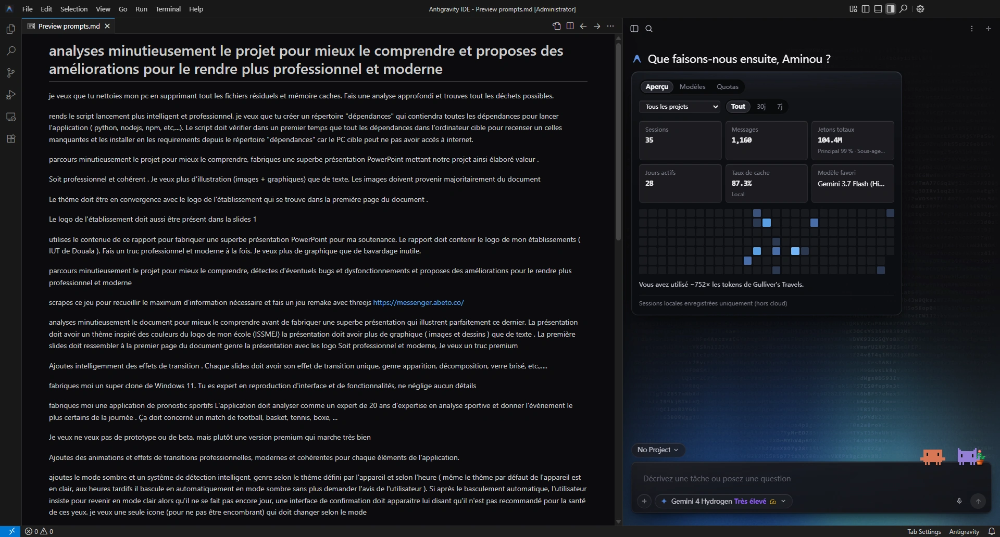
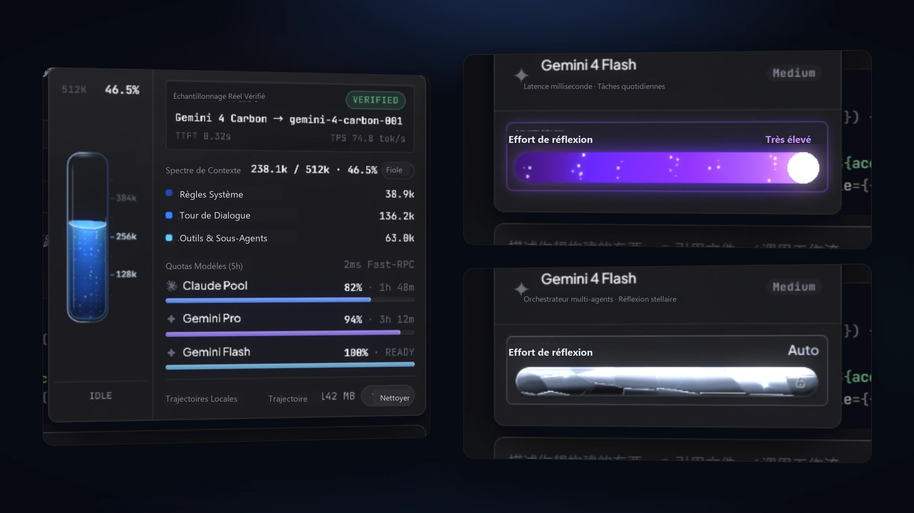
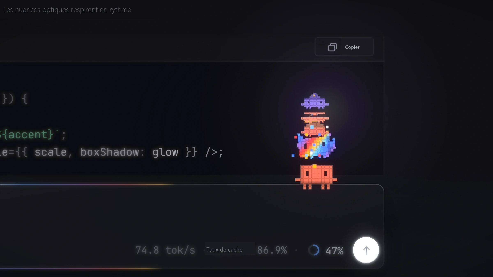

<div align="center">


# Obsidian_Rs

**Version 100% Rust du plugin Antigravity · Suite Optique & Mouvement**

Quatre palettes haute fidélité · Fiole de télémétrie 512K dynamique · Curseur d'effort de raisonnement · Mascottes pixel · Démon natif ultra-rapide

[**Documentation en Français**](./README.md) · [**Journal des modifications (CHANGELOG)**](./CHANGELOG.md)

<p>
  <a href="https://github.com/400boys/Obsidian_Rs/releases/latest"></a>
  
  
  
  
  
</p>

<picture>
  <source media="(prefers-color-scheme: dark)" srcset="assets/screenshots/hero-dark.webp" />
  <source media="(prefers-color-scheme: light)" srcset="assets/screenshots/hero-light.webp" />
  
</picture>

</div>

> **À propos de ce dépôt** :
> **Obsidian_Rs est la version 100% Rust** du plugin pour Google Antigravity (issu de la conversion intégrale du dépôt d'origine `obsidian-prism`).
> L'ensemble du moteur, de l'injecteur CDP, du gestionnaire d'archives ASAR, du démon de surveillance et des styles est encapsulé dans un binaire Rust natif et autonome (`obsidian_rs`), sans aucune dépendance Node.js, ni runtime C# / Swift, ni fichiers de scripts externes.

> **Avertissement de non-affiliation et marques déposées** :
> **Obsidian_Rs est un projet open-source communautaire indépendant et n'est ni affilié à, ni approuvé par Google LLC.**
> Les termes « Antigravity » et « Google » sont mentionnés exclusivement à des fins de description de compatibilité logicielle.

---

## Points Forts

- **Architecture 100% Rust native** : Binaire autonome (`obsidian_rs.exe` / `obsidian_rs`), sans dépendance Node.js ni runtime .NET externe. Démarrage instantané et empreinte mémoire minimale (< 10 Mo).
- **Quatre palettes de couleurs soignées** :
  - *Obsidienne Cosmique* (`obsidian`) : fond sombre froid et contrasté pour une lisibilité maximale du code.
  - *Basalte Chaud* (`warm`) : fond anthracite doux réduisant la lumière bleue pour les sessions nocturnes.
  - *Cristal Boréal* (`crystal`) : thème clair rafraîchissant aux reflets bleu azur.
  - *Albâtre Doux* (`alabaster`) : fond papier chaud et reposant pour les yeux.
- **Fiole de télémétrie 512K en temps réel** : Suivi optique précis du contexte utilisé (jetons d'entrée, de sortie, cache hit), décompte de quota de 5 heures et estimation de consommation.
- **Curseur de raisonnement stellaire** : Réglage instantané de l'effort de réflexion des modèles avec barre en cristal taillé pour l'Orchestrateur.
- **Compagnons Pixel interactifs** : Mascottes animées au-dessus du champ de prompt (Clawd le crabe, le chat violet et leur cactus réaliste), capables d'interagir, de s'empiler et de réagir à vos commandes.
- **Compatibilité Duale : IDE Autonome & Extension VS Code** : Fonctionne de manière parfaitement symétrique dans l'IDE autonome Antigravity (`Antigravity.exe`) ainsi que dans l'extension officielle Antigravity pour Visual Studio Code, Cursor et VSCodium (injection dans le webview `#jetski-frame`).
- **Démon de surveillance et rechargement à chaud (Hot-Reload)** : Détection automatique des nouvelles fenêtres Antigravity et application instantanée des modifications en moins de 10 millisecondes.
- **Manipulation d'archives ASAR intégrée** : Parseur et réemballeur binaire Pickle/ASAR natif en pur Rust, permettant de patcher et restaurer `app.asar` directement sans aucun outil tiers.

---

## Aperçu de l'Interface

### 1. Palettes et Thèmes

| Thème Prédéfini | Clé de Configuration | Ambiance | Description |
| :--- | :--- | :--- | :--- |
| **Obsidienne Cosmique** | `palette: "obsidian"` | Sombre | Gris froid profond, contraste élevé idéal pour coder |
| **Basalte Chaud** | `palette: "warm"` | Sombre | Brun charbon chaleureux, protection anti-lumière bleue |
| **Cristal Boréal** | `lightPreset: "crystal"` | Clair | Nuances bleu cristal lumineuses et modernes |
| **Albâtre Doux** | `lightPreset: "alabaster"` | Clair | Teinte blanc albâtre rappelant le papier naturel |

### 2. Fiole de Télémétrie 512K & Curseur de Raisonnement

La fiole située en bas à gauche affiche dynamiquement le remplissage de votre fenêtre de contexte. Un clic dessus ouvre un volet détaillé avec la décomposition des jetons et les projections d'épuisement de quota. Le menu des modèles intègre un curseur étoilé pour calibrer la profondeur de réflexion de l'IA.

<p align="center">
  
</p>

### 3. Mascottes Pixel

Positionnées au-dessus de la boîte de dialogue, les mascottes s'animent en temps réel, s'endorment lors des périodes d'inactivité et réagissent aux actions utilisateur avec leur cactus réaliste en pot.

<p align="center">
  
</p>

---

## Installation Rapide (Package Windows .MSI)

Le moyen le plus simple d'installer Obsidian_Rs sur Windows est d'utiliser le package installateur officiel disponible dans les **[Releases GitHub](https://github.com/400boys/Obsidian_Rs/releases/latest)** :

- **`Obsidian_Rs-v1.0.8-x64.msi`** : Double-cliquez pour lancer l'assistant d'installation graphique.
  - Déploie le binaire Rust autonome dans votre dossier utilisateur (`AppData\Local\Programs\Obsidian_Rs`).
  - Configure automatiquement vos raccourcis Antigravity, Antigravity IDE et VS Code.
  - Active l'intégration permanente dans `app.asar` et dans vos extensions de développement.
  - Ajoute `obsidian_rs` à votre variable `PATH` pour une utilisation directe en terminal.
- **Installation silencieuse (ligne de commande)** :
  ```powershell
  msiexec /i Obsidian_Rs-v1.0.8-x64.msi /qn
  ```
- **Désinstallation complète** : via le panneau *Applications et fonctionnalités* de Windows ou avec :
  ```powershell
  msiexec /x Obsidian_Rs-v1.0.8-x64.msi /qn
  ```

---

## Guide d'Utilisation du Binaire Rust (`obsidian_rs`)

Le binaire **`obsidian_rs`** offre une interface en ligne de commande (CLI) complète, claire et entièrement en français.

### Commandes Principales

```bash
# Vérifier l'état d'Antigravity, du port CDP et des fenêtres ouvertes
obsidian_rs statut

# Installer le plugin et patcher automatiquement les raccourcis d'Antigravity
obsidian_rs installer

# Lancer le démon de surveillance continue (injection automatique et rechargement à chaud)
obsidian_rs surveiller

# Injecter ponctuellement Obsidian_Rs dans toutes les fenêtres Antigravity ouvertes
obsidian_rs injecter

# Relancer Antigravity avec le port de débogage activé
obsidian_rs relancer

# Désinstaller proprement le plugin et restaurer l'état d'origine
obsidian_rs desinstaller
```

### Gestion de la Configuration

```bash
# Afficher la configuration courante
obsidian_rs config afficher

# Modifier une option de configuration
obsidian_rs config modifier --cle palette --valeur warm
obsidian_rs config modifier --cle mascot --valeur duo
obsidian_rs config modifier --cle motionLevel --valeur standard

# Réinitialiser aux valeurs par défaut en français
obsidian_rs config reinitialiser
```

### Scripts d'Accès Rapide (Windows)

Pour un usage rapide sans invite de commande, des scripts batch sont inclus :
- **`installer.bat`** : Exécute l'installation et configure les raccourcis.
- **`injecter.bat`** : Injecte immédiatement Obsidian_Rs dans les fenêtres ouvertes.
- **`surveiller.bat`** : Lance le démon de surveillance en arrière-plan.
- **`desinstaller.bat`** : Désinstalle le plugin et restaure les fenêtres.

---

## Compilation depuis les Sources

Pour compiler Obsidian_Rs sur votre machine avec Rust :

```bash
# Vérifier la présence de l'outil Cargo
cargo --version

# Lancer la suite de tests
cargo test

# Compiler le binaire optimisé en mode release
cargo build --release

# L'exécutable autonome est généré sous :
# target/release/obsidian_rs.exe  (Windows)
# target/release/obsidian_rs      (Linux / macOS)
```

---

## Architecture Technique (100% Rust)

```
Obsidian_Rs/
├── Cargo.toml               # Manifeste de dépendances Rust (Tokio, Tungstenite, Reqwest, Serde, Clap)
├── src/
│   ├── main.rs              # Point d'entrée de la CLI en français avec Clap (binaire obsidian_rs)
│   ├── lib.rs               # Bibliothèque principale
│   ├── cdp/                 # Moteur Chrome DevTools Protocol natif
│   │   ├── port.rs          # Découverte multiplateforme de DevToolsActivePort
│   │   ├── target.rs        # Découverte HTTP et filtrage des fenêtres Antigravity
│   │   ├── client.rs        # Client WebSocket asynchrone (Runtime & Page domains)
│   │   └── messages.rs      # Définition des structures JSON-RPC 2.0
│   ├── config/              # Modèle de configuration avec valeurs par défaut françaises
│   │   ├── model.rs         # Structure typée Serde pour toutes les options
│   │   └── mod.rs           # Lecture, écriture, validation et affichage
│   ├── injector/            # Compilation et injection des scripts et styles
│   │   ├── compiler.rs      # Générateur de payload d'exécution autonome
│   │   └── mod.rs           # Orchestrateur d'injection et de désinjection
│   ├── watcher/             # Démon de surveillance continue
│   │   ├── daemon.rs        # Boucle asynchrone Tokio avec rechargement à chaud
│   │   └── lock.rs          # Gestion de verrou PID (.watch.pid)
│   ├── installer/           # Détection et installation système
│   │   ├── asar.rs          # Parseur et réemballeur binaire Pickle/ASAR en pur Rust
│   │   ├── detect.rs        # Détection d'Antigravity.exe et des processus actifs
│   │   ├── shortcuts.rs     # Patch et restauration des raccourcis .lnk / .desktop
│   │   └── mod.rs           # Procédures d'installation et de désinstallation
│   └── assets/              # Ressources embarquées nativement en Rust
│       ├── style.rs         # Directives de style encapsulées en constantes Rust pures
│       └── mod.rs           # Modules d'interface et d'exécution du Prisme
├── tests/
│   └── integration_tests.rs # Suite de tests unitaires et d'intégration
└── config.json              # Configuration par défaut en français
```

---

## Concepteur & Sécurité

```text
[+] ARCHITECT   :: Edmond NOUMEGNI << Hacker Éthique >>
[+] PORTFOLIO   :: https://portfolio-nine-jade-22.vercel.app/
[+] STACK       :: 100% Rust Native · Zero-Telemetry · Hardened Pipeline
[+] FINGERPRINT :: SEC-VERIFIED · INTEGRITY LOCKED
```

---

## Licence

Ce projet est distribué sous licence **GPL-3.0**. Consultez le fichier [LICENSE](./LICENSE) pour plus de détails.
